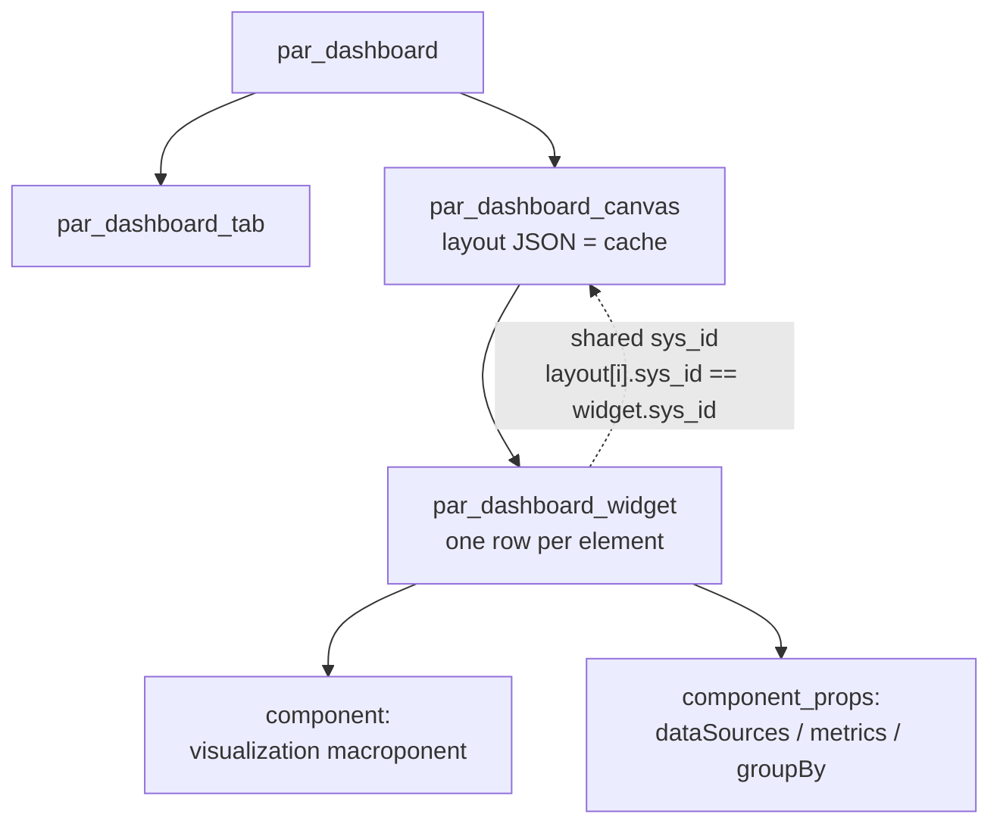

# Dashboards and read-only views: what to build, and what you can script

The question: *"can you programmatically create a set of dashboards showing a good
mix of data — starting on this week — and what does ServiceNow best practice
actually recommend for read-only viewing?"*

Short answer: **script the reports, assemble the dashboard once by hand.** Reports
are ordinary records and fully automatable; the modern dashboard container is a
UI Builder artefact and is not.

---

## 1. The options, and what each is for

| Option | What it is | Scriptable? | Use it when |
|---|---|---|---|
| **Reports** (`sys_report`) | A saved query + visualisation. 733 already on this instance. | ✅ **verified** | Always — this is where the analytical content lives |
| **Dashboard** (`par_dashboard`) | The container that lays reports out on a canvas | ❌ see §2 | You want them side by side |
| **UI Builder** (`sys_ux_page`) | Custom task-driven experience with your own components | ⚠️ technically, but authored in the UI | Users need to *act*, not just look |
| **Service Portal** (`sp_page`) | Self-service portal page | ⚠️ widgets are code | External / unauthenticated audiences |
| **UI Pages** (`sys_ui_page`) | Legacy Jelly pages | ⚠️ | Almost never. Legacy. |
| **Homepages** (`sys_home`) | Legacy landing pages | ⚠️ | Almost never. Legacy. |

All of those tables exist on this instance, so availability is not the constraint
— the constraint is which one is *supported* for this job.

---

## 2. Why the dashboard container is not scriptable (the important finding)

I dumped the schema. `par_dashboard` has nine columns:

```
experience            reference   Experience
grid                  integer     Grid
sys_ux_app_config     reference   UX App Configuration
sys_ux_app_route      reference   UXF Page Route
sys_ux_macroponent    reference   UXF Page Macroponent
sys_ux_screen         reference   UX Screen
sys_ux_screen_type    reference   UX Screen Collection
```

**Five of the seven real columns point at UI Framework artefacts.** A dashboard
is a set of `sys_ux_*` records, each carrying JSON component configuration. To
create one over REST you would have to fabricate a screen, a screen type, an app
route, a macroponent and an app config, then wire the dashboard to all of them.

That is not "programmatic" in any useful sense: it is reverse-engineering an
internal format that is free to change between releases. It would break on
upgrade and nobody could maintain it.

The legacy path (`pa_dashboards`) is not an escape either — it now carries
`experience_dashboard`, `should_migrate_permissions` and `no_bulk_migration`,
i.e. it is the deprecated model being folded into PAR.

**So the supported split is:**

```
reports    →  scripted, version-controlled, re-runnable, testable
dashboard  →  assembled once in the UI, takes ~2 minutes,
              then automatically shows every report you script
```

That is also the honest reading of ServiceNow's own guidance: for read-only
operational visibility, use **Reports + Dashboards**. UI Builder is for
write-oriented experiences. UI Pages are legacy.

---

## 2b. Correction: the dashboard *shell* IS creatable

I claimed `par_dashboard` was "not realistically creatable over REST". **That was
too strong.** Tested directly:

| Attempt | Result |
|---|---|
| `POST pa_dashboards` (legacy PA dashboard) | ❌ **403 even as admin** — "ACL Exception Insert Failed due to security constraints" |
| `POST par_dashboard` (new PAR dashboard) | ✅ **succeeds** (bare `{}` was accepted, then deleted) |
| `POST sys_dashboard` (old core-UI "Dashboard Layout") | ✅ succeeds |
| `POST sys_dashboard_detail` | n/a — only takes `gauge_id` (→ Gauge), no report reference |

So the shell is scriptable. What is **not** scriptable is a populated dashboard,
and the reason is specific:

A PAR dashboard's content lives in `par_dashboard_canvas.layout` — a JSON array
of widget descriptors:

```json
[{"x":24,"y":52,"w":24,"h":14,
  "name":"% high priority incidents",
  "component_id":"2bd5dc19a7ad083941b7c992a966dd78",
  "component_props":"{\"configVersion\":\"23.0.0-ci-SNAPSHOT\", ... }"}]
```

Each widget's `component_props` is an 81-key blob whose data binding is a
**Performance Analytics indicator**, base64-encoded:

```json
"metrics":[{"dataSource":"aW5kaWNhdG9yNzZmZDU5NjBiZjMzMDEwMGI5NmRhYzgwOGMwNzM5N2MxNjk5NDY5NTUyNzY5",
            "id":"YVc1a2FXTmh..."}],
"dataSources":[{"indicatorType":"1","isScriptedIndicator":false, ...}]
```

(`aW5kaWNhdG9y…` decodes to `indicator76fd5960…`.) There is **no `reportSysId`** in
any widget — the only "report" key in the whole corpus is a boolean
`newReporting`. So PAR dashboard widgets render **indicators**, not
`sys_report` records.

Placing the 12 reports on a dashboard therefore needs either a full PA indicator
build (a different artifact entirely, with scheduled data collection), or the
UI's "Add to dashboard", which does the report→widget wrapping on your behalf.

**Which dashboard type is best:** the **new PAR dashboard**. The legacy
`pa_dashboards` model is both the one that is 403-blocked over REST *and* the one
ServiceNow is retiring — `analytics_dashboard` carries a `ready_to_migrate`
field, and there is a `par_dashboard_conversion_backup` table, both evidence of
an active migration programme. `sys_dashboard` is the oldest core-UI layout and
only holds gauges; avoid it.

Practical sequence: create the `par_dashboard` shell programmatically, then
populate it in the UI. The shell carries the name, owner and grid so it appears
in the dashboards list ready to fill.

## 2c. RESOLVED — a populated dashboard IS scriptable. §2 and §2b were wrong.

**`create_dashboard.py` builds a working PAR dashboard. This section is the
verified recipe; an earlier revision of it was wrong and is corrected below.**

Four records, in this order:

| Record | What it holds | Required? |
|---|---|---|
| `par_dashboard` | name, grid, active | ✅ |
| `par_dashboard_tab` | tab name, order | ✅ |
| `par_dashboard_canvas` | `layout` JSON with per-widget placement | ✅, with `dashboard_tab` set at CREATE |
| `par_dashboard_widget` | **one row per layout element** | ✅ — the renderer reads these |



### The three defects that made it render nothing

These are worth reading in order, because each one looked like success from the
API and only a human opening the page revealed it.

**1. `par_dashboard_canvas.layout` is only a cache.** The renderer reads
`par_dashboard_widget` rows. The two are joined by a *shared sys_id*:
`layout[i]["sys_id"]` must equal the widget row's `sys_id`. A canvas with 12
layout elements and 0 widget rows renders as **"Add your first element"**.

**2. There is no `reportSysId` prop.** An earlier revision of this doc claimed
the `Report/PA Widget` macroponent renders a `sys_report` via `reportSysId`.
That is **false on this release**. Scanning all 318 `par_dashboard_widget` rows
on the instance found `reportSysId` in exactly one place: the widgets that had
just been created. No native widget uses it. Setting it produces, per widget:

> Can't display this information — You are either not authorized or the record is
> not valid

PAR widgets here are **Platform-Analytics-native**. Data is declared inside
`component_props`, not referenced:

```json
{
  "dataSources": [{
    "sourceType": "table",
    "tableOrViewName": "u_toronto_event",
    "filterQuery": "u_start>javascript:gs.endOfCurrentMinute()^EQ",
    "id": "<base64>", "label": "...",
    "preferredVisualizations": ["<viz macroponent id>"],
    "dataCategories": ["trend","group","simple"],
    "allowRealTime": true, "isDatabaseView": false
  }],
  "metrics": [{
    "dataSource": "<same base64 id>",
    "aggregateFunction": "COUNT",
    "axisId": "primary", "id": "<base64>",
    "numberFormat": {"customFormat": false},
    "dateFormat": {"customFormat": false},
    "stringFormat": {"customFormat": false}
  }],
  "groupBy": [{
    "groupBy": [{"dataSource":"<same id>","groupByField":"u_source",
                 "isRange": false, "isChoice": true, "isPaBucket": false}],
    "maxNumberOfGroups": 12, "showOthers": true,
    "numberOfGroupsBasedOn": "NO_OF_GROUP_BASED_ON_PER_METRIC",
    "disableRanges": false
  }]
}
```

Observed `sourceType` values across all native widgets: `table` (147),
`indicator` (102). There is no `report` sourceType.

**3. `component` (the widget row's visualization macroponent) is mandatory.**
Every one of the 318 native rows sets it; `stored_component` is optional (221
omit it). Leaving `component` empty is what produces *"the record is not
valid"* — there is no component to instantiate.

| Visualization | Macroponent | Native rows |
|---|---|---|
| Single score | `d24d53f60350de7a652caf3188a46ed2` | 101 |
| Vertical bar | `23051643b7e03010097cb81cde11a910` | 35 |
| Column | `2bd5dc19a7ad083941b7c992a966dd78` | 29 |
| Line | `18ac962264404bcc0039359d184b15f3` | 26 |
| Donut | `a2b0596cec6b9d49dd1ff9bf76b5084b` | 22 |
| Pie | `96abe7e38d8790718022c5630a92176c` | 13 |
| Horizontal bar | `85855283b7e03010097cb81cde11a91d` | 9 |

`pa_widgets.py` holds this table and clones the cosmetic prop defaults from a
native, working widget (`specs/pa_widget_template.json`), so axis/legend/empty-
state settings are whatever the platform itself writes rather than guesses.

### Caveats that cost time

1. **`dashboard_tab` must be set when the canvas is CREATED.** A `PATCH` on an
   existing canvas returns `200` and silently does not persist — the tab stays
   blank. Recreate the canvas instead.
2. **`pa_dashboards` (legacy) still cannot be created** — 403 "security
   constraints" even as admin. Only `par_dashboard` works.
3. **Rebuild with `--update`, never delete-then-create.** Deleting mints a new
   `sys_id`; any open tab, bookmark or shared link to the dashboard then shows
   *"Can't display this dashboard — not found"*. `--update` reuses the
   `par_dashboard` and its tab, and replaces only canvas + widget rows.
4. **Rebuilding invalidates widget sys_ids**, so a browser tab open across a
   rebuild will 404 when a widget is clicked. Refresh the page.

### Verified structure

```
par_dashboard         Toronto Events              868ff1c4c3589310310abf0d050131cf
par_dashboard_tab     Overview                    468f35c4c3589310310abf0d0501312d
par_dashboard_canvas  (tab-linked, 12 elements)   a38086c8c3589310310abf0d05013197
par_dashboard_widget  12 rows, component set
```

`create_dashboard.py` verifies by re-reading, and prints a **pre-flight count**
for every widget — it runs each widget's own encoded query against the table via
the Table API, so a widget that would show zero says so before anyone opens the
page:

```
Toronto Events — This Week         comp=d24d53f6 group=-          rows=351
Toronto Events — By Source         comp=2bd5dc19 group=u_source   rows=11940
Toronto Events — Data Quality: No  comp=d24d53f6 group=-          rows=2
```

**Still requires a human:** whether it *paints*. The API can prove the records
are right, the filters return data, and every widget has a component — it cannot
prove pixels.

## 2d. The dashboard in use: feeds, filters, breakdowns

`specs/dashboard_toronto_events.json` describes 18 widgets. A `kind` field picks
the component, so one script builds sections rather than just charts:

| kind | Component | What it is |
|---|---|---|
| `chart` | Single score / Column / Donut / Horizontal bar / Line | count or group-by, defined in `specs/reports_toronto_events.json` |
| `heading` | Heading | section title |
| `list` | List - Simple | live record feed — the "happening today" panels |
| `filter` | Filter | dashboard filter pill (multiselect or date) |

Layout on the 48-column grid:

```
y=0    Category ▾ | When ▾ | Source ▾                        (3 filters)
y=4    Toronto events at a glance
y=6    Today | Tomorrow | Next 7 days | Next 30 days          (4 scores)
y=15   Happening today          | Happening in the next 3 days
y=17   Today's events (list)    | Coming up (list)
y=35   Where and what
y=37   Top venues (bar)         | By category (donut)
y=55   How the feed is moving
y=57   Events added (line)      | By source (column)
```

### Per-visualization templates are mandatory

There is no single `component_props` skeleton. Each visualization needs its own
`extensionType`, `dataCategory` and (sometimes) `trendBy`:

| kind | extensionType | dataCategory | trendBy |
|---|---|---|---|
| column | `bar` | `group` | populated |
| horizontal_bar | — | `group` | null |
| donut | — | `group` | null |

Reusing one skeleton across chart types produced, on a Column chart:

> Invalid configuration — A 'Trend By' must be selected for the visualization to
> render.

A chart with no `dataCategory` is treated as a trend chart, and trend charts are
refused without `trendBy`. `specs/templates/chart_<kind>.json` therefore holds one
captured template per visualization, each taken from a native widget that renders.

When cloning a template that already carries a `trendBy`, its
`trendByFields[].metric` points at the *source* widget's metric — it must be
remapped onto the new widget's own metric id and its own date field, or the chart
draws the wrong series. `pa_widgets.build_props()` does both.

### Two derived columns the dashboard depends on

`backfill_geo_category.py` adds and maintains them (idempotent, `--dry-run`):

| Column | Type | Why |
|---|---|---|
| `u_primary_category` | string 50 | `u_categories` is a CSV: 221 distinct combinations for 11,940 events. The first token gives 11 clean buckets (Arts 4,475 / General 3,042 / Sports 1,266 …), which is what makes a category filter usable. `u_categories` is untouched for search. |
| `u_location_ref` | reference → `cmn_location` | 440 `cmn_location` records created, one per venue with coordinates; 9,599 events referenced. Verified by dot-walking `u_location_ref.latitude`. |

## 2e. The geo map: solved

The Geomap is on the dashboard. The three unknowns from the first attempt are
resolved, and the first was the real blocker.

**1. `mapSysId` is the BASEMAP, not the data mapping.** It references
**`sys_report_map`** — the GeoJSON geometry records (World, countries, states).
The native widget uses `93b8a3a2d7101200bd4a4ebfae61033a`, `key=world`. That id
is *not* in `sys_report_map_source`, which is why searching there came up empty
and the prop looked unresolvable. It was found by querying every table whose
name contains "map" for that sys_id: exactly one hit.

**2. Map sources are a parent/child chain.** A business rule named *"If parent is
empty set empty values"* nulls `type`, `type_mapping` and `join_by_column` unless
`parent` is set. The write returns HTTP 200 and `sys_mod_count` increments while
the values stay empty — a silent no-op. Mirrored from native:

| level | parent | type | type_mapping | aggregate_field |
|---|---|---|---|---|
| root | — | — | — | `u_location_ref` |
| Level 1 | root | Level 1 | mapping | `u_location_ref.country` |
| Level 2 | Level 1 | Level 2 | mapping | `u_location_ref.state` |
| Level 3 | Level 2 | Level 3 | **use_lat_lon** | `u_location_ref` |

`create_map_source.py` builds this and **re-reads each record to assert
`type_mapping` actually persisted** — trusting the 200 was the earlier mistake.

**3. Coordinates come from a location record.** All 52 native map sources walk a
reference; none reads a bare lat/lng column pair. `u_location_ref` ->
`cmn_location` (440 records, 9,599 references, built by
`backfill_geo_category.py`) supplies latitude/longitude, and
`type_mapping=use_lat_lon` tells the map to use it.

### The widget

```
component            Geomap             9c8c44bd78fe5918950e0db8e286211d
mapSysId             World basemap      93b8a3a2d7101200bd4a4ebfae61033a
dataSources[0]       u_toronto_event    filterQuery u_location_refISNOTEMPTY^EQ
metrics[0]           COUNT
groupBy[0]           u_location_ref
filterConfigurations @state.parFilters
followFilters        true
```

`@state.parFilters` + `followFilters: true` is what makes the Category / When /
Source pills redraw the map — the same pairing native filter-aware widgets use.

Pre-flight: **9,598 rows** sit behind the map (events whose venue resolved to a
`cmn_location`); the remaining ~2,300 have no feed coordinates.

**Still needs a human:** that it paints. Every input is verified — basemap,
mapping chain including persistence, reference resolution via dot-walk, and row
count — but no API confirms rendering.

## 2f. Dashboard filters: the `dynamicTimeRange` trap

Adding a date filter broke **every** widget on the dashboard that follows
filters, not just the filter itself:

> Invalid configuration. Invalid value for dynamicTimeRange field:
> SN_DYNAMIC_DATERANGE__NEXT_30_DAYS

The token is not invalid. All ten `SN_DYNAMIC_DATERANGE__*` values appear in
native widgets' `allowedDateRanges`, and a native filter happily defaults to
`SN_DYNAMIC_DATERANGE__LAST_7_DAYS`.

The real requirement: **a selected date range needs a matching
`filterConfigurations` entry to bind to.** A native date filter looks like

```json
"defaultSelectedDateRange": {"range": "SN_DYNAMIC_DATERANGE__LAST_7_DAYS", "label": "Last 7 days"},
"filterConfigurations": [{"filterId": "1ha0739qjl097777h8o",
                          "start": "2023-09-06", "end": "...", "apply_to": []}]
```

Mine had a `defaultSelectedDateRange` and `filterConfigurations: []`, so the
renderer had no `filterId` to attach the range to and rejected the value. The
failure then surfaces on every filter-aware widget, which makes it look like a
chart bug rather than a filter bug -- the four score cards and both feeds all
reported the same error.

Current behaviour: the date filter ships with **no preselected range**
(`enableResetToDefault: false`, no `defaultSelectedDateRange`, ten options in
`allowedDateRanges`). The dashboard therefore opens unconstrained and a human
picks a range. To preselect one later, `filterConfigurations` must be populated
too -- a default alone will fail the same way.

### Debugging tip

To find which record carries a bad value, do not trust the widget named in the
error. Scan every widget's `component_props` **and** the canvas `layout` JSON:

```python
for w in widgets:
    if "DYNAMIC" in w["component_props"]: ...
```

That is what isolated it to one field on one filter.

## 2g. Dashboard filters are ANDed — so absolute windows must opt out

Setting the date filter to a single day produced numbers that looked broken:

| card | showed | true count |
|---|---|---|
| Today | **0** | 69 |
| Tomorrow | **66** | 66 |
| Next 7 days | **66** | 276 |
| Next 30 days | **66** | 1,243 |

Nothing was misconfigured. **A dashboard filter is ANDed with each widget's own
condition**, so every card collapsed to "the one selected day" — 66 events on
2026-10-28. The list breadcrumb showed the conflict outright:

```
All > Start between 2026-10-28 00:00:00 and 2026-10-28 23:59:59
    > Start >= 2026-10-27 00:00:00 > Start <= 2026-10-27 23:59:59
```

Two date constraints, from two different sources, intersecting.

"Today" showed 0 because of a **timezone offset**, not a query bug.
`glide.sys.default.tz` is unset and the admin user's `time_zone` is empty, so the
server's `gs.beginningOfToday()` resolves to **2026-10-27** while the instance
clock reads `2026-10-28 05:05` UTC. A filter for 10-28 AND "today"=10-27 is the
empty set.

Ground truth per day (from the Table API, no relative functions):

```
2026-10-27   69
2026-10-28   66      <- what the dashboard filters to
2026-10-29   73
```

### The fix: `followFilters`

Every widget now declares whether it should obey dashboard filters:

- `followFilters: false` — **absolute windows**: Today, Tomorrow, Next 7 days,
  Next 30 days, and the two feeds (Today's events, Coming up). These keep their
  own self-consistent meaning no matter what is selected above them.
- `followFilters: true` — the "Matching the Category / When / Source filters"
  list and all charts, so selecting a date or category genuinely filters them.

The general rule: **a widget whose name asserts a fixed window must not follow
filters; a widget that represents "what you selected" must.**


`specs/reports_toronto_events.json` + `create_reports.py` create **12 reports** on
`u_toronto_event`:

## 2h. Saying what "Today" means, and why the map shows fewer rows

### Two numbers that look contradictory but aren't

The map reported **59** for a day on which the "Today's events" list showed
**66**. Measured, not guessed:

| filter | count |
|---|---|
| all events on 2026-10-28 | **66** |
| + has a location reference (map-eligible) | **59** |
| + state = ON | 59 |
| + city = Toronto | 59 |

The 7-row gap is events whose venue has **no coordinates in the feed** — North
York Centre, Edill's Coffee House, Cafe Princess, 1750 Finch Avenue East, Rita
Café, Starbucks @ Yonge & Hwy 7 and one more. Their feed rows carry no lat/lng
at all, so no `cmn_location` record could be created and the map cannot place
them. Across the whole table: **9,600 map-eligible, 2,344 not**.

That is a data-coverage limit, not a query bug. The dashboard now says so in a
note above the cards rather than leaving the user to discover it.

### Explicit window labels

The cards were renamed so a mid-sentence reading is unambiguous, and a rich-text
widget states the rules in-product:

- `Today — all day`, `Tomorrow — all day` = 00:00–23:59 of that calendar day
- `Today — still to come` = now → 23:59 today, so it **falls to 0 as the day
  ends**; just after midnight every day card resets (the new day, not a fault)
- `Next 7 days — rolling`, `Next 30 days — rolling` = forward from this minute
- `All upcoming (no end date)` = everything still ahead

The note also states that these cards **ignore** the page filters while the list
and charts below follow them — the single most confusing asymmetry on the page.

Give the rich-text widget 10 grid rows (`h: 10`). At `h: 4` the five bullets
overflow and the widget scrolls internally, which hides the very explanation it
exists to show.

### The sync must derive the map fields, or the map decays

`import_events.py` does not populate `u_primary_category` or `u_location_ref` —
they are derived. Anything the nightly sync **inserts** is therefore missing
from the category chart and invisible on the map until a backfill runs.

This was found live: three rows had drifted within hours of the last manual
backfill. `deploy/run-sync.sh` now runs `backfill_geo_category.py` after the
import (idempotent — one scan, PATCHes only absent/stale values), and warns
instead of failing the whole sync if it errors.

## 2i. Two tabs, and correcting the filter-scope rule

The dashboard now has two tabs, both built from one spec (`tabs: [...]`; a spec
with a plain `widgets` list still works and becomes a single "Overview" tab):

| Tab | Contents |
|---|---|
| **Overview** | 6 absolute cards, the filter-driven list, two feeds, the map, breakdowns |
| **Integration & Health** | 6 health metrics, events-per-sync-batch chart, and rich-text runbook (integration details, design summary, backup/recovery) |

`create_dashboard.py` reuses tabs **by name** on `--update`, creates one canvas
per tab (with `dashboard_tab` set at create time), and creates the widget rows
per canvas. It now also syncs `par_dashboard.description` from the spec — earlier
`--update` left stale text behind because only INSERT set it.

### The `followFilters` rule, corrected

§2g said absolute windows must set `followFilters: false`. That was too blunt and
it broke the category filter: with `false` on the two feeds, selecting **Dating**
changed nothing in "Happening today" / "next 3 days".

The refined rule:

- `followFilters: false` — **only the six KPI cards**, which are absolute
  calendar/rolling counts by definition.
- `followFilters: true` — **the two feeds, the matching list, all charts, and
  the map.** A user who picks a category expects the lists to narrow.

The feeds were renamed to say so: "Today's events — matches filters" and
"Coming up — matches filters".

Residual trade-off, accepted deliberately: the feeds keep their own date window,
so a *When* filter pointing outside that window legitimately returns nothing.
That is coherent for a widget that asserts a window, and the unbounded
"Matching the filters" list covers the other case.

### Sparse categories look like a broken filter

Worth recording because it looked like a bug:

```
Dating, any date                 384
all categories, today             69
Dating, today                      0   <- so a filtered feed is correctly empty
all categories, next 3 days      139
Dating, next 3 days                0
Dating, all upcoming               3
```

Only 3 Dating events exist in the next 60 days (Nov 1, Nov 6, Dec 1). A narrow
category combined with a 1–3 day window is empty by data, not by defect. The
in-product note now states this and points at "Matching the filters".

## 3. What was actually built

```bash
python create_reports.py specs/reports_toronto_events.json --dry-run
python create_reports.py specs/reports_toronto_events.json
```

Verified output: `RESULT: 12/12 reports present on u_toronto_event`, and a re-run
reports `created 0 · skipped 12 · failed 0` — idempotent, matched by title.

| Report | Type | Answers |
|---|---|---|
| **This Week** | single score | what's on right now (351 today) |
| **Upcoming** | single score | everything still ahead (2,433) |
| **Next 7 Days** | single score | rolling forward window (276) |
| **Free vs Paid** | donut | cost mix (10,376 free of 11,940) |
| **By Source** | bar | which feed/scraper contributed what |
| **By Status** | donut | will surface cancellations the moment the feed carries them |
| **By Duration Category** | pie | single vs multi-day |
| **Multi-Day** | single score | 878 |
| **Upcoming By Source** | horizontal bar | who is supplying what's actually ahead |
| **Added This Week** | single score | did the sync add anything, or was it a no-op |
| **No Coordinates** | single score | quality metric; 2,341 rows |
| **No Start Date** | single score | should stay near zero |

The two **data-quality** reports are the ones people forget to build. `u_lat` is
empty on 2,341 rows — without a metric, you discover that when a map report
silently renders blank months later.

---

## 4. "Start on this week" — use relative filters, never frozen dates

A report filtered to fixed dates is stale the following Monday. Use the relative
date functions so the content maintains itself:

| Intent | Encoded query | Measured today |
|---|---|---|
| this calendar week | `u_start>=javascript:gs.beginningOfThisWeek()^u_start<=javascript:gs.endOfThisWeek()` | **351** |
| rolling 7 days ahead | `u_start>=javascript:gs.now()^u_start<=javascript:gs.daysAgoStart(-7)` | **276** |
| anything upcoming | `u_start>javascript:gs.now()` | **2,433** |
| created by the sync this week | `sys_created_on>=javascript:gs.beginningOfThisWeek()` | varies |

Prefer **Next 7 Days** over **This Week** as the headline number: "this week"
collapses to zero every Monday morning, which looks like an outage. A rolling
window is what a planner actually wants.

If the dashboard should *default* to this week, set the dashboard's own date
filter rather than baking it into each report — then one control changes the whole
canvas.

---

## 4a. What the UI actually writes into a filter (measured)

I claimed earlier that authoring a relative date through the condition builder
produces a native `RELATIVE` condition with no `javascript:` in it. **That was
wrong.** Here is what the UI produced when a date condition was set to
*"start is after current minute"* on `u_toronto_event` and saved:

```
u_start>javascript:gs.endOfCurrentMinute()^u_sourceISNOTEMPTY^EQ
```

Three things to take from that:

1. **The condition builder emits `javascript:` functions itself.** So the 5
   scripted reports that use `javascript:gs.*()` are not a quirk of writing
   filters through the API — they use the same vocabulary the UI does. The
   portability concern I raised is therefore much smaller than I made it sound.
2. **The UI's own date vocabulary** includes `gs.now()`, `gs.endOfCurrentMinute()`,
   `gs.beginningOfThisWeek()`, `gs.endOfThisWeek()`, `gs.daysAgoStart()`. "After
   current minute" specifically maps to `gs.endOfCurrentMinute()`.
3. **The UI appends `^EQ`.** That is a query terminator the builder adds to mark
   the end of the condition list. It is benign in a stored filter, but it is the
   reason a UI-authored filter and an API-authored one can differ by a suffix
   while behaving identically:

```
API-written : u_start>javascript:gs.now()
UI-written  : u_start>javascript:gs.endOfCurrentMinute()^EQ
same rows   : 2433 in both cases
```

### Which means the picker options ARE addressable programmatically

"after Current minute" is not an alternative to `javascript:` -- it *is*
`javascript:gs.endOfCurrentMinute()`. The condition builder recognises the
function and renders it back as a friendly dropdown value. There is no separate
non-JavaScript encoding to aim for.

Every relative function the picker can express works as a raw filter, verified on
this instance:

| Picker choice | Stored form | rows (`u_start > ...`) |
|---|---|---|
| Current minute | `javascript:gs.endOfCurrentMinute()` | 2433 |
| Now | `javascript:gs.now()` | 2433 |
| Today (start) | `javascript:gs.beginningOfToday()` | 2502 |
| Today (end) | `javascript:gs.endOfToday()` | 2433 |
| This week (start) | `javascript:gs.beginningOfThisWeek()` | 2555 |
| This week (end) | `javascript:gs.endOfThisWeek()` | 2204 |
| This month (start) | `javascript:gs.beginningOfThisMonth()` | 3901 |
| 7 days ahead | `javascript:gs.daysAgoStart(-7)` | 2157 |
| 7 days ago | `javascript:gs.daysAgoStart(7)` | 2909 |
| End of next week | `javascript:gs.endOfNextWeek()` | 1919 |

So `create_reports.py` can produce exactly what the picker produces. The spec now
uses `gs.endOfCurrentMinute()` for "after now" cases and appends the `^EQ`
terminator, matching the builder's own output byte for byte.

`create_reports.py --update` reconciles existing reports against the spec
(patching `filter`, `type`, `field`, `aggregate` only). Verified behaviour-
preserving: after rewriting 10 of 12 filters, every row count was unchanged
(351 / 2433 / 276 / 878 / 2341 identical before and after).

### Practical consequence

Editing one of these reports in the UI and saving will rewrite its filter into
the UI's form. That is harmless — but if you want a report to stay byte-identical
to what is in `specs/reports_toronto_events.json`, do not edit it in the UI, or
expect `create_reports.py` to see it as a different record (it matches on title,
so it will simply skip it).

### Why the 5 `javascript:` filters stay (final answer)

**Yes — 5 of the 12 filters still contain `javascript:`, deliberately:**
This Week, Upcoming, Next 7 Days, Upcoming By Source, Added This Week.

They stay because the native `RELATIVE` operator cannot express what they need.
I finally pinned down why. `RELATIVE` anchors on **"the same position within the
period, N periods ago"** — it does not mean "the start of the period":

| Filter | Rows | What it actually means |
|---|---|---|
| `u_startRELATIVEGT@month@ago@0` | 2433 | *today* onward (same day-of-month, 0 months ago) — identical to `> endOfToday`, **not** the 1st of the month |
| `u_startRELATIVEGT@year@ago@10` | 11938 | start within 10 years — sensible |
| `u_startRELATIVEGT@day@ago@0` | 2 | broken |
| `sys_created_onRELATIVEGT@day@ago@0` | **0** | broken — all 11,940 rows *were* created today |

That last row is the proof: if `@day@ago@0` worked, it would return 11,940. It
returns 0. So even the tokens that appear to work are not dependable.

**Conclusion:** there is no `RELATIVE` expression for "from the start of this
calendar week" or "from now to exactly 7 days ahead". Those are boundary-aligned
concepts, and `javascript:gs.beginningOfThisWeek()` / `gs.daysAgoStart(-7)` are
the only way to say them.

Which is fine, because **the UI writes exactly the same thing.** Authoring "after
Current minute" in the condition builder produces
`javascript:gs.endOfCurrentMinute()`. Scripted and UI-authored filters are the
same family, and there is no "more out-of-box" form being missed.

The one thing a non-`javascript:` approach *would* buy is portability to an
instance with `javascript:` disabled in encoded queries. If that ever matters,
the answer is not a different operator — it is a dashboard-level date control, or
materialising a boolean/date bucket column during the sync (e.g. `u_is_this_week`)
and filtering on that, which is plain equality and needs no functions at all.

### The attempt that did NOT work

Before checking the UI, I tried to hand-derive the native operator form:

```
u_startRELATIVEGT@week@ago@0    -> 2 rows      (expected ~351)
u_startRELATIVEGT@week@later@0  -> 2 rows
u_startRELATIVELT@week@later@0  -> 2 rows
u_startRELATIVEGT@dayofweek@ago@0 -> 2433 rows (coincidence, means something else)
```

None of them map cleanly onto "this calendar week". I left the verified
`javascript:` filters in place rather than swap a known-good count of 351 for an
unexplained 2. Lesson: when a syntax guess and a measurement disagree, believe
the measurement and keep what works.

## 5. Assembling the dashboard (one time, ~2 minutes)

1. **All → Dashboards → New dashboard**
2. Name it `Toronto Events`, pick the **Events** audience/roles
3. For each report: open it → **Add to dashboard** → choose `Toronto Events`
4. Arrange on the canvas. Suggested layout:

```
┌──────────────┬──────────────┬──────────────┐
│  This Week   │  Next 7 Days │   Upcoming   │   ← three KPIs across the top
├──────────────┴──────────────┴──────────────┤
│        By Source (bar)                     │
├─────────────────────┬──────────────────────┤
│  Free vs Paid donut │  By Status donut     │
├─────────────────────┴──────────────────────┤
│  Data quality row: no coords · no start date│
└────────────────────────────────────────────┘
```

When you add a new report later, `create_reports.py` creates it and you drop it
on the canvas — the container never needs rebuilding.

---

## 6. Permissions

Reports and dashboards inherit the table's ACLs, so **Part 5 of the README comes
first**. A dashboard is not a security boundary: if `u_toronto_event` is readable
by everyone (which it is until you add ACLs), every report on it is too.

Set the dashboard's audience to the same role that can read the table — `itil`
in our setup — so the two do not drift.

---

## 7. What not to do

| Anti-pattern | Why |
|---|---|
| UI Page (Jelly) for a data view | Legacy tech, no upgrade path, no reason to choose it |
| UI Builder for a read-only list | You get a macroponent to maintain instead of a report; only worth it if users must *act* |
| Hard-coded date ranges in reports | Stale content that silently looks like an outage |
| A dashboard as the only definition of the content | The reports are the durable, scriptable artefact — keep them in git |
| Assuming a dashboard enforces security | It does not; table ACLs do |
| `SELECT *`-style "show everything" reports | Every column the sync will break your layout |

---

## 8. Cleanup

Every report written by this script is listed in the spec, so removal is
symmetric:

```bash
python create_reports.py specs/reports_toronto_events.json --delete
```

It deletes only the titles named in the spec, and only from the spec's table.
